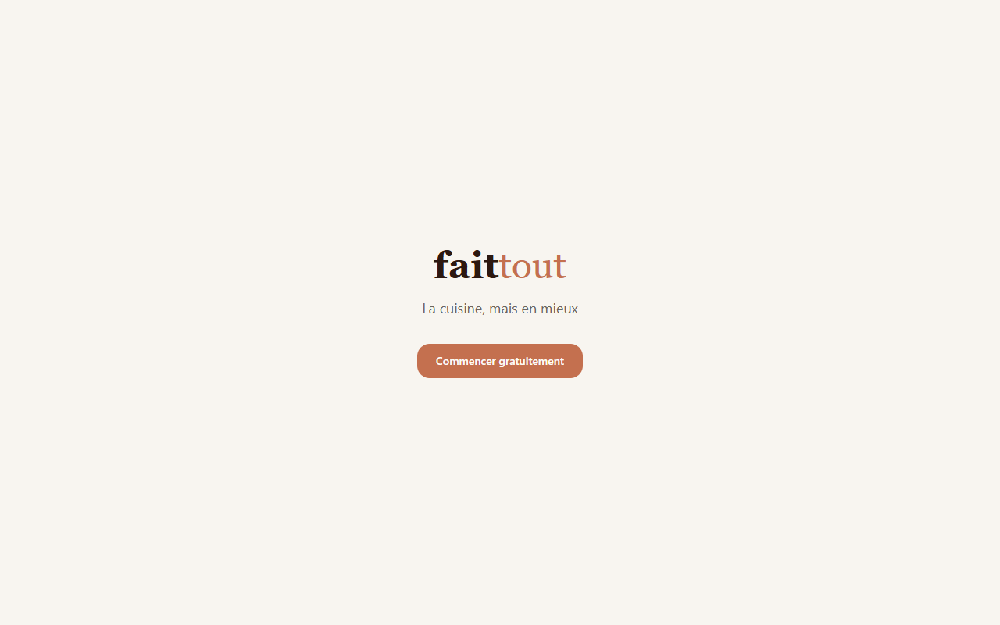
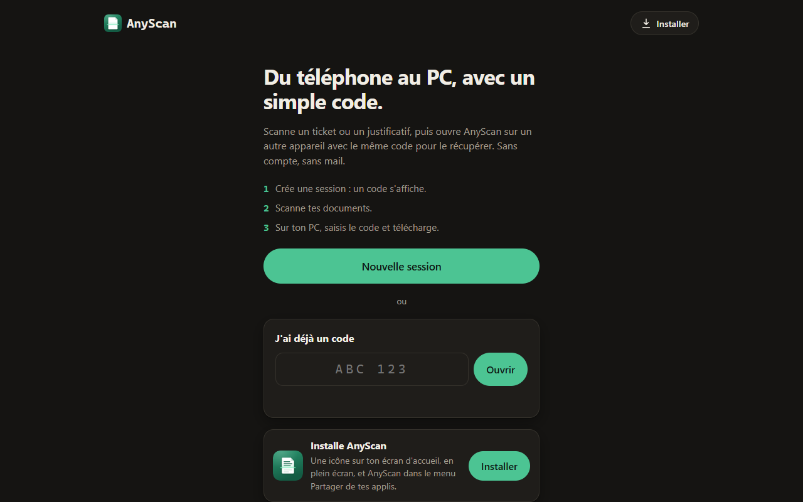
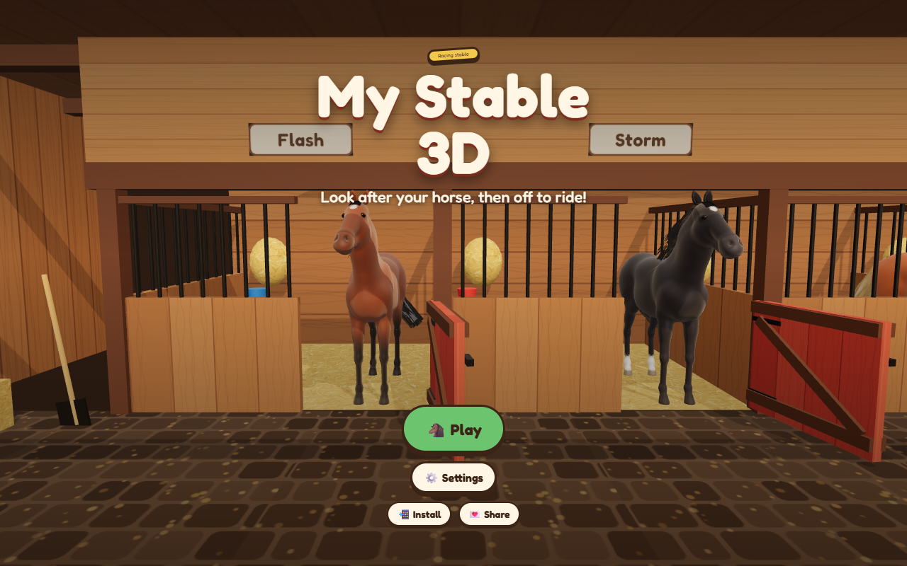
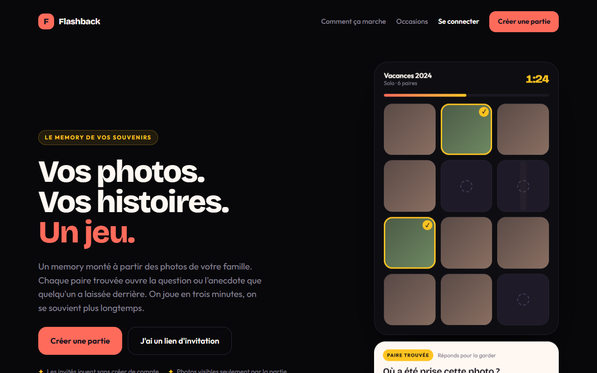
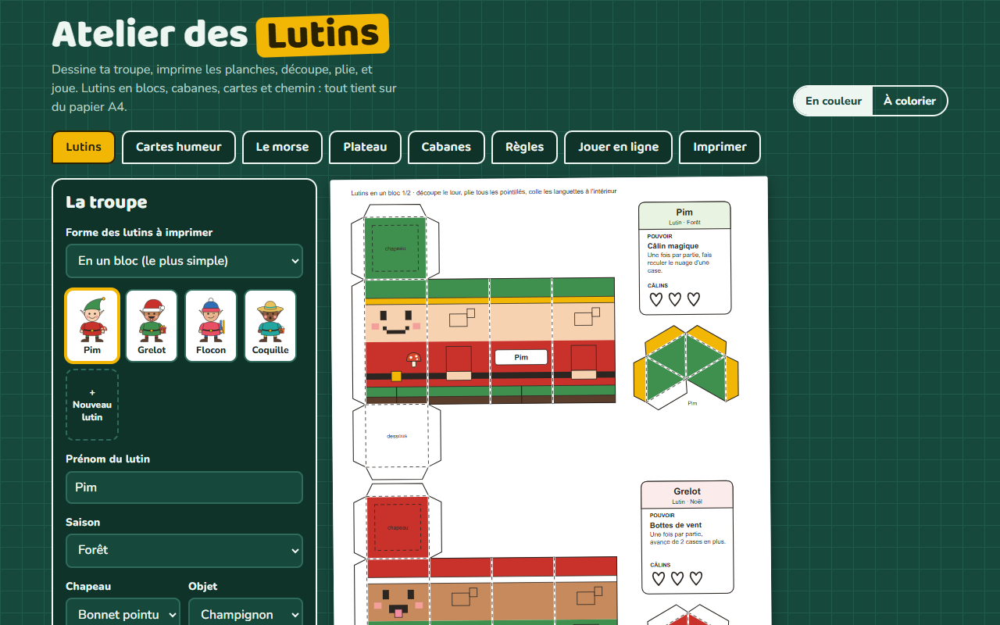
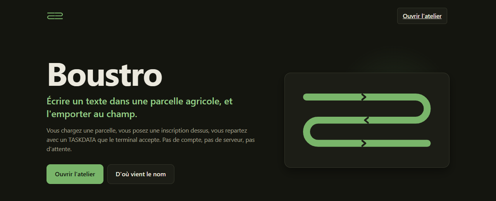
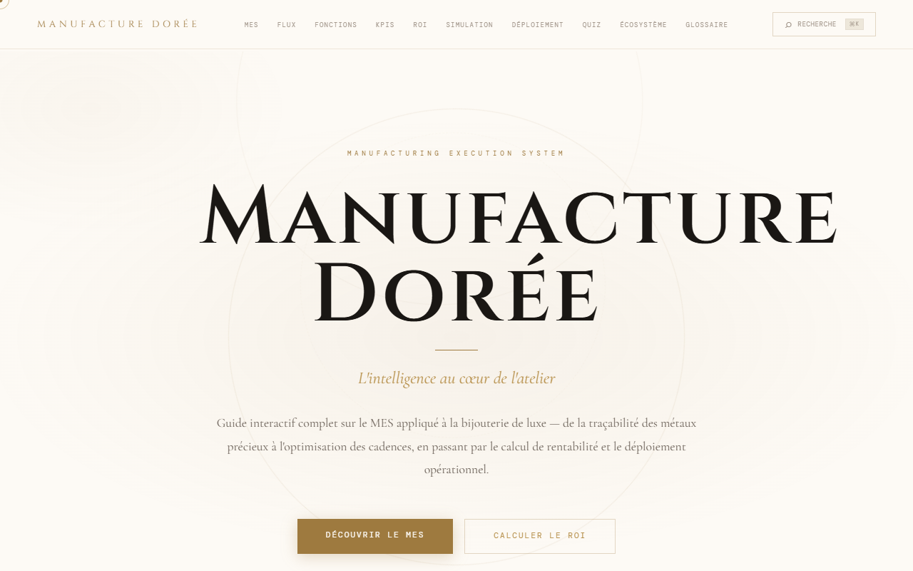

<h1 align="center">Bonjour 👋</h1>

  <b>Je conçois des applications web utiles, pour la maison comme pour le métier.</b>

<i>🇬🇧 A selection of web apps I built and run in production. Every app below is live: click a screenshot to try it.</i>

---

## 🚀 Mes applications

Toutes ces applications sont en ligne et utilisables gratuitement, sans installation. La plupart s'installent aussi sur téléphone comme une app native (PWA).

### 🏠 Vie quotidienne

<table>
  <tr>
    <td width="50%" valign="top">
      
      <h3><a href="https://fait-tout.vercel.app">Faitout</a></h3>
      Gérez vos recettes, planifiez vos repas et suivez vos objectifs nutritionnels.  
      
      
    </td>
    <td width="50%" valign="top">
      
      <h3><a href="https://anyscan.vercel.app">AnyScan</a></h3>
      Scannez un ticket ou un justificatif sur votre téléphone et récupérez-le sur n'importe quel appareil avec un simple code. Sans compte, sans mail.  
      
    </td>
  </tr>
  <tr>
    <td width="50%" valign="top">
      <h3><a href="https://routine-enfant.vercel.app">Routine Enfant</a></h3>
      Les routines quotidiennes des enfants, avec des histoires, des récompenses et un suivi parental.  
      
      
    </td>
    <td width="50%" valign="top"></td>
  </tr>
</table>

### 🎮 Jeux & créativité

<table>
  <tr>
    <td width="50%" valign="top">
      
      <h3><a href="https://emma-galop.vercel.app">My Stable 3D</a></h3>
      Prenez soin de votre cheval de course : boxe, pansage, sellerie, puis balade en carrière, en cross, sur l'hippodrome ou en forêt.  
      
      
    </td>
    <td width="50%" valign="top">
      
      <h3><a href="https://flashback-memory-kltv.vercel.app">Flashback</a></h3>
      Un jeu de memory monté à partir de vos photos de famille : chaque paire trouvée révèle une question ou une anecdote.  
      
      
    </td>
  </tr>
  <tr>
    <td width="50%" valign="top">
      
      <h3><a href="https://atelier-des-lutins.vercel.app">Atelier des Lutins</a></h3>
      Composez votre troupe de lutins et imprimez les planches à découper : figurines, cartes humeur, plateau et cabanes.  
      
      
    </td>
    <td width="50%" valign="top"></td>
  </tr>
</table>

### 🏭 Métier & industrie

<table>
  <tr>
    <td width="50%" valign="top">
      
      <h3><a href="https://boustro.vercel.app">Boustro</a></h3>
      Écrivez un texte dans une parcelle agricole et exportez-le en ISOXML TASKDATA pour terminal ISOBUS, et en shapefiles. Tout est calculé dans le navigateur.  
      
      
    </td>
    <td width="50%" valign="top">
      
      <h3><a href="https://gold-manufacture.vercel.app">Manufacture Dorée</a></h3>
      Un guide interactif sur le MES (Manufacturing Execution System) appliqué à la bijouterie de luxe : traçabilité, cadences, calcul du ROI et déploiement.  
      
    </td>
  </tr>
</table>

---

Le code source de ces projets est privé.

